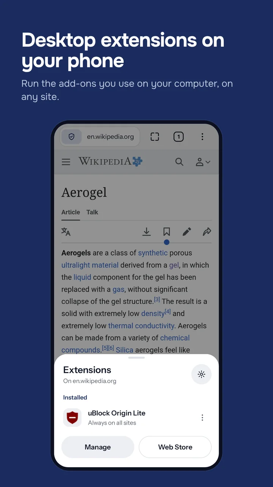
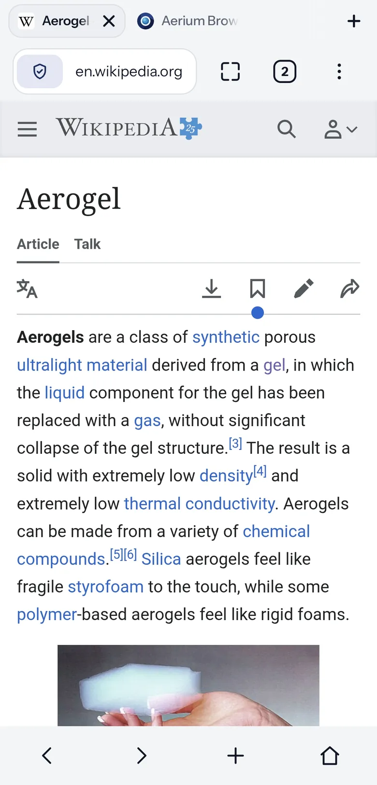
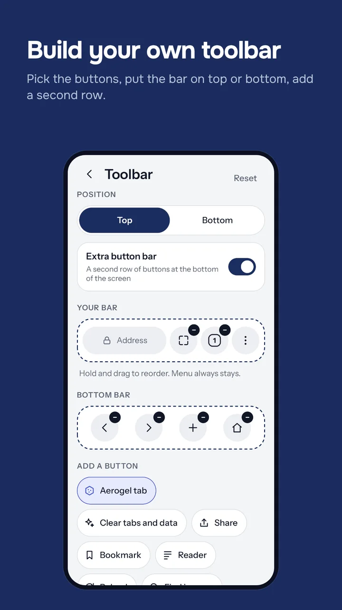
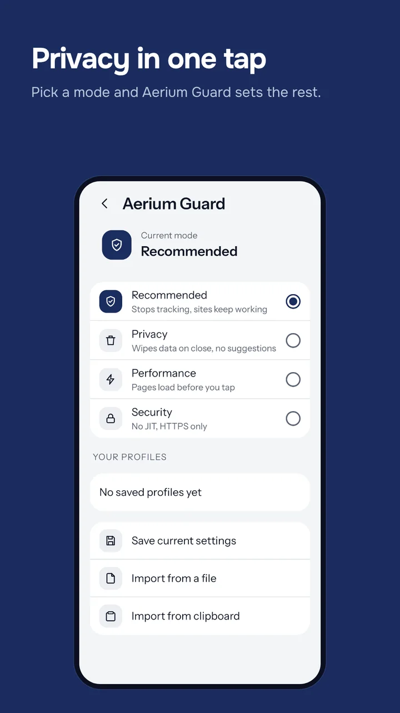

<div align="center">


# Aerium

**The Android browser that runs real Chrome extensions.**

uBlock Origin Lite and Chrome Web Store extensions, on current Chromium.

<a href="https://github.com/aerium-browser/aerium-browser-core/releases/latest"></a>
<a href="https://github.com/aerium-browser/aerium-browser-core/releases"></a>
<a href="https://chromiumdash.appspot.com/releases?platform=Android"></a>
<a href="https://github.com/aerium-browser/aerium-browser-core/stargazers"></a>
<a href="LICENSE"></a>

[**Join the closed test**](#google-play) &nbsp;&nbsp;|&nbsp;&nbsp; [Download the APK](https://github.com/aerium-browser/aerium-browser-core/releases/latest) &nbsp;&nbsp;|&nbsp;&nbsp; [Website](https://aeriumbrowser.com)

<a href="#google-play"></a><br>
<sub>Closed test, open to everyone. <a href="#google-play">Join in three steps</a>.</sub>

<a href="https://alternativeto.net/software/aerium-browser/about/?utm_source=badge&utm_medium=referral"></a>&nbsp;
<a href="https://www.androidauthority.com/google-chrome-alternatives-android-based-on-chromium-3726016/#:~:text=Honorable%20mentions"></a>

<br>

&nbsp;
&nbsp;
&nbsp;


</div>

<br>

## What's changed

Aerium is no longer based on Vanadium or any of its forks. It's now built on pure Chromium, straight from the source, with nothing in between.

The whole interface has been redesigned, and the next release brings a lot of new things: a toolbar you build yourself, desktop style tabs, a home screen widget, search shortcuts, sleeping tabs, a mobile data saver and cookie banners rejected for you. Until the redesign is stable, new releases take a bit longer while we fix bugs and polish everything. Thanks for your patience.

Follow [Announcements](https://github.com/aerium-browser/aerium-browser-core/discussions/categories/announcements) to stay up to date.

## Why Aerium

Aerium is built straight from Chromium's own source, not on top of another browser or fork. Nothing sits in between, so when a new Chromium version comes out, Aerium moves to it right away instead of waiting for another project to catch up first. That keeps Aerium on the same Chromium version as Chrome itself.

## Compared with other browsers

How Aerium differs from other Chromium based browsers on Android, as of November 2026. These browsers change often, so check their own documentation for the current state.

| Browser | Desktop extensions |
|---|---|
| **Aerium** | Chrome Web Store and `.crx` |
| Brave | Not supported |
| Vivaldi | Chrome Web Store, not every extension works |
| Cromite | Experimental, behind a flag |
| Chrome | Not supported |

| Browser | Fingerprinting |
|---|---|
| **Aerium** | In Aerium Guard's Privacy mode, sites see a different fingerprint every session |
| Brave | Randomized per site, new seed every session, same fingerprint in private and regular tabs |
| Vivaldi | No randomization |
| Cromite | Noise on several APIs |
| Chrome | None |

| Browser | Source and Google services |
|---|---|
| **Aerium** | Engine patches under GPLv3, app layer closed source. Google services removed, no telemetry |
| Brave | Open source. Google services removed, privacy preserving usage stats (P3A) |
| Vivaldi | Vivaldi account and sync services |
| Cromite | Open source. Google services removed, no telemetry |
| Chrome | Chromium is open source, Chrome is not. Full Google integration |

| Browser | Bundled extras |
|---|---|
| **Aerium** | None |
| Brave | Crypto wallet, Leo AI, VPN, News, Rewards |
| Vivaldi | Partner speed dials, Vivaldi Translate |
| Cromite | None |
| Chrome | Gemini, Discover feed, Google Lens |

| Browser | Private browsing |
|---|---|
| **Aerium** | Aerogel tabs. Sites can be set to always open there, links from other apps can open there, extensions are allowed one by one |
| Brave | Private tabs |
| Vivaldi | Private tabs |
| Cromite | Incognito, with an option to always use it |
| Chrome | Incognito |

## Features

**Extensions.** Install from the Chrome Web Store, or a `.crx` from GitHub. Open any extension from the toolbar, choose which ones also run in Aerogel, and their popups fit the screen.

**Privacy.** Aerium Guard modes in one tap, a different fingerprint every session in Privacy mode, Global Privacy Control on every request, tracking parameters stripped from links, redirect trackers and AMP skipped, cookie banners rejected when you ask, stricter site isolation, and Google's background services switched off.

**Aerogel.** Private tabs with their own window, per site rules for what gets deleted, and links from other apps can open there by default.

**Yours to customize.** Address bar on top or bottom, a toolbar you build button by button with an optional second row, your own menu order, desktop style tabs, true black dark mode, alternate app icons and a home screen widget in three sizes.

**Made for daily use.** Search shortcuts for your favorite sites, an address bar that always shows the site name in full, sleeping tabs to save battery, a mobile data saver, a video player made for phones, backup and restore with your extensions, and an update check that never installs anything without asking.

## Install

### Google Play

Aerium is in closed testing and anyone can join. Use the same Google account for every step.

1. **Join** the [Aerium testers group](https://groups.google.com/g/aeriumbrowser)
2. **Opt in** on the [testing page](https://play.google.com/apps/testing/com.aeriumbrowser.android)
3. **Install** from [Google Play](https://play.google.com/store/apps/details?id=com.aeriumbrowser.android)

Google Play can take a few minutes to show the app after you join.

### GitHub releases

The APKs on the [releases page](https://github.com/aerium-browser/aerium-browser-core/releases) are the same ones Google Play delivers, so the two can update each other. New versions reach Google Play first.

Check the signing certificate's SHA-256 fingerprint, for example with [AppVerifier](https://github.com/soupslurpr/AppVerifier):

```
FC:20:0D:57:1C:59:12:E3:8D:02:A2:CB:82:21:F3:2C:F4:79:34:20:2E:61:2D:CA:76:B5:1E:07:3C:FB:27:4B
```

On Android 12 and older:

```
BD:ED:28:12:DF:1D:31:54:C0:1A:E7:13:89:D4:52:D9:21:00:02:00:D4:66:C1:90:4D:9A:DF:A8:45:68:5D:D4
```

### First start

Pick uBlock Origin Lite during setup, or add any extension from the Chrome Web Store. The store opens in its desktop layout by itself.

## How it's built

This repository is the open core: Chromium plus every engine change Aerium makes.

The patches go onto Chromium's own source from `chromium.googlesource.com`, pinned in [`chromium.pin`](chromium.pin). No other browser sits in between, so a new Chromium release never waits on anyone else.

```
patches/     Chromium edits, one feature per patch
defaults/    every changed default in one table
api/         the interface the app is built on
bridge/      its engine side
build.sh     fetch, patch, compile
```

Fork it and run the **Build** workflow, it builds on GitHub runners and resumes on its own. Or run `./build.sh` on Linux.

## Community

Questions, ideas, bug reports or just want to say what you think? Head to [Discussions](https://github.com/aerium-browser/aerium-browser-core/discussions). It's the best place to reach us and other Aerium users, and it's where we post news about upcoming releases. Before opening an issue, take a quick look there, your question may already be answered.

### Official channels

Aerium is only published on GitHub, at [aeriumbrowser.com](https://aeriumbrowser.com) and on Google Play. We don't run ads and have no official accounts on Reddit or other social networks. Posts elsewhere come from users, not from us. Download Aerium only from these sources.

## Support

No ads, no investors, no data sales. Aerium is built in spare time and paid for out of pocket. Many independent browsers before it were abandoned because nobody could keep paying for them, and Aerium can not go much further without your support either. Donations go to real costs like the Google Play developer fee and the domain. If Aerium is useful to you, any amount in [Monero](https://aeriumbrowser.com/donate/xmr), [Litecoin](https://aeriumbrowser.com/donate/ltc) or [Bitcoin Lightning](https://aeriumbrowser.com/donate/btc) keeps it alive. A star helps too.

## License

[GPLv3](LICENSE). Chromium keeps its BSD license. The Aerium name and logo are trademarks of Aerium Browser, see [NOTICE](NOTICE). Security reports go through [SECURITY.md](SECURITY.md).
